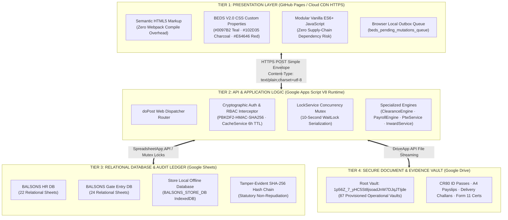
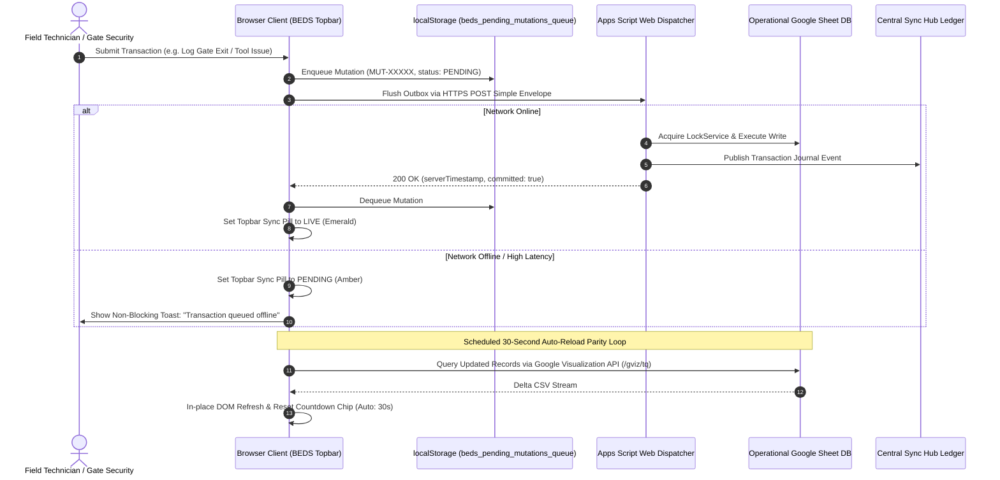
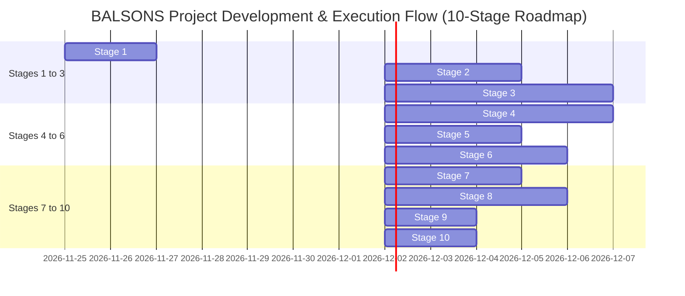

# BALSONS MULTI-PORTAL ENTERPRISE ECOSYSTEM (2026)
## MASTER ENGINEERING SPECIFICATION & GREENFIELD EXECUTION PLAN
**Authoritative Reference Document:** `BAL-ENG-MASTER-DOSSIER-2026-V1.0`  
**Governing Architectural Standard:** BALSONS Standard Architecture Model (`SAM-2026`)  
**Design System Standard:** BFast Enterprise Design System (`BEDS V2.0`) & WCAG 2.1 AA  
**Enterprise Corporate Entity:** BALSONS Heavy Lift & Shift  
**Anchor Industrial Project:** Jupiter Tatravagonka Railwheel Factory (JTRWF), Khordha, Odisha  
**Workspace Root Boundary:** `D:\jupiter files from\BALSONS PORTALS 2026`  
**Implementation Mandate:** 100% Greenfield Execution — Zero legacy baggage, independent cloud-native operational data stores, orchestrated via the Central Sync Hub.

---

## 1. EXECUTIVE SUMMARY & STRATEGIC MANDATE

### 1.1 Enterprise Context: JTRWF Khordha
BALSONS Heavy Lift & Shift operates as the principal heavy engineering and heavy lift contractor at the **Jupiter Tatravagonka Railwheel Factory (JTRWF)** in Khordha, Odisha. The operational theatre is characterized by extreme-load erection operations, heavy machinery logistics, high-risk work environments, and strict statutory labor compliance:
* **Heavy Erection Workfronts:** 600 MT crawler cranes, 1000 MT Schuler hydraulic wheel press lines, axle-machining multi-spindle lines, and multi-axle hydraulic pullers (SPMTs).
* **Dual-Wage Workforce Composition:** Highly skilled permanent engineers and site supervisors alongside day-to-day contract technicians and riggers who operate under contractor labor welfare exemptions.
* **Perimeter Traffic Volume:** High-frequency inward delivery of raw steel billets and wheel axles, outward movement of calibrated rigging gear, returnable tools/tackles (RGP), non-returnable scrap steel dispatches (NRGP), and heavy transporters.
* **Zero-Defect Statutory Compliance:** Absolute adherence to the Factories Act (Form 31/32 Medical, Form 11 Lifting Tackles), BOCW Act, Contract Labour (Regulation & Abolition) Act, Minimum Wages Act, EPF, ESIC, and Odisha State Labor Welfare policies.

### 1.2 Greenfield Architecture Mandate
This ecosystem is designed, architected, and deployed as a **100% greenfield implementation**. It eliminates legacy technical debt, brittle npm/webpack build toolchains, and insecure development backdoors. The ecosystem comprises **7 synchronized components**:
1. **BALSONS Central Enterprise Launcher (`index.html`)**
2. **BALSONS HR & Dual-Wage Payroll Manager**
3. **BALSONS JTRWF Gate Entry & Site Access Portal**
4. **BALSONS Safety, EHS & PTW Governance Portal**
5. **BALSONS Store & Rigging Tackle Manager**
6. **BALSONS Commercial Purchase & Vendor Manager**
7. **BALSONS Operations & Heavy Erection Manager**

---

## 2. MANDATORY TECHNOLOGY ARCHITECTURE & CORE PRINCIPLE (`SAM-2026`)

### 2.1 The Core Operating Principle
> **"Google Sheets = Database | Google Apps Script = Main Engine | Git = Frontend Source & Hosting Link | Google Drive = Document Management. All components must operate as one integrated BALSONS enterprise system."**

### 2.2 Mandatory Technology Architecture Matrix
* **DATABASE:** **Google Sheets** — All structured operational data, multi-tab relational schemas, formula rollups, and audit trails.
* **MAIN ENGINE:** **Google Apps Script (V8 Runtime)** — Serverless backend, REST/POST APIs, business logic, deterministic payroll, gate clearance, permissions, automation, and Google Drive integration.
* **FRONTEND:** **HTML + CSS + JavaScript via Git** — Complete BALSONS portal interface, BEDS V2.0 design tokens, responsive layouts, client controllers, maintained and published via a BALSONS-owned Git repository.
* **DOCUMENT REPOSITORY:** **Google Drive** — Integrated, portal-wise structured folder vault (87 provisioned folders under Root ID `1p56Z_7_yHC5St8jsoadJnW7DJqJTIjde`) with secure upload, storage, search, and retrieval.
* **SYNCHRONIZATION:** **BALSONS Central Sync Hub** — Bi-directional Controlled Dual Sync, scheduled 30-second parity engine, and client-side outbox mutation queue.

### 2.3 The 4-Tier Serverless Architecture Model
The entire ecosystem operates on a decoupled, 4-tier serverless topology engineered for sub-second field responsiveness, zero server OS patching, and high industrial resilience:




### 2.1 Tier Specifications & Technical Rationales
1. **Tier 1 (Presentation):** Semantic HTML5 + Vanilla ES6+ modules + BEDS V2.0 tokens. Delivers instant load times ($< 1.2\text{ s}$ FCP on 4G) and allows site workers to pinch-to-zoom on technical drawings (`width=device-width, initial-scale=1.0` without zoom disabling flags).
2. **Tier 2 (API & Logic):** Google Apps Script (V8 runtime) serverless execution. Eliminates cold-start infrastructure costs. Employs `LockService` (10,000 ms timeout) to serialize database writes, preventing concurrency collisions during simultaneous gate punches or payroll approvals.
3. **Tier 3 (Database):** Multi-sheet relational workbooks structured with immutable primary keys and foreign keys. All headers styled with `#102D35` dark teal background, `#FFFFFF` bold text, and frozen header rows. Every mutation writes an audit record with SHA-256 hash chaining.
4. **Tier 4 (Evidence Vault):** Google Drive Enterprise Master Storage with 87 provisioned sub-vaults under Root Folder ID `1p56Z_7_yHC5St8jsoadJnW7DJqJTIjde`.

---

## 3. GLOBAL IDENTITY, RBAC & ZERO-TRUST SECURITY GOVERNANCE

### 3.1 The Canonical Governance Rule
> **"ONE SUPER ADMINISTRATOR • ALL PORTALS • ALL DATA • COMPLETE CONTROL. ALL OTHER USERS RECEIVE ONLY ASSIGNED ACCESS."**

### 3.2 6-Tier Authority Hierarchy & Role Matrix
The ecosystem enforces a strict 6-tier Role-Based Access Control (RBAC) hierarchy managed via `balsons-sam-auth.js`:

| Role Tier | Code | Scope & Authority | Confidential HR / Payroll Access | Default Avatar & Badge |
| :--- | :--- | :--- | :---: | :---: |
| **Tier 1: Super Administrator** | `SUPER_ADMIN` | Unrestricted global access to all 7 portals, master records, system configs, audit logs, and user CRUD. | **Full** | `👑` `badge-super-admin` |
| **Tier 2: Management / Director**| `MANAGEMENT` | High-level executive oversight across assigned portals (Operations, Purchase, Safety, Store). | **Restricted** (Forbidden) | `🏛️` `badge-management` |
| **Tier 3: Portal Administrator** | `PORTAL_ADMIN` | Full administrative control strictly within the assigned single operational portal. | Only if assigned to HR | `🛡️` `badge-portal-admin` |
| **Tier 4: Department Head (HOD)** | `HOD` | Operational approval authority over departmental personnel, requisitions, and allocations. | **Restricted** | `👔` `badge-hod` |
| **Tier 5: Site Supervisor** | `SUPERVISOR` | Field management, shift attendance logging, toolbox talk execution, and permit requests. | **Restricted** (Masked) | `👷` `badge-supervisor` |
| **Tier 6: Employee / Technician**| `EMPLOYEE` | Self-service profile viewing, personal payslip download, and personal pass verification. | Own Records Only | `👤` `badge-employee` |

### 3.3 Canonical Bootstrap Accounts & Default Credentials

```javascript
// Master Canonical User Roster (Pre-configured in SAM-2026 Engine)
const INITIAL_USERS = [
  {
    username: "superadmin",
    fullName: "Prashant Muley (Executive Super Administrator)",
    email: "balsonsportals@gmail.com",
    role: "SUPER_ADMIN",
    assignedPortals: ["ALL"],
    canAccessConfidentialHR: true,
    isLocked: true // Primary Immutable Account
  },
  {
    username: "director.mgmt",
    fullName: "Satish Chandra (Management Director)",
    email: "director@balsons.com",
    role: "MANAGEMENT",
    assignedPortals: ["safety", "operations", "purchase", "store", "launcher"],
    canAccessConfidentialHR: false
  },
  {
    username: "admin.hr",
    fullName: "Priyanka Senapati (HR Portal Admin)",
    email: "hr.admin@balsons.com",
    role: "PORTAL_ADMIN",
    assignedPortals: ["hr_payroll"],
    canAccessConfidentialHR: true
  },
  {
    username: "admin.gate",
    fullName: "Bikash Mohapatra (Gate Portal Admin)",
    email: "gate.admin@balsons.com",
    role: "PORTAL_ADMIN",
    assignedPortals: ["gate_entry"],
    canAccessConfidentialHR: false
  },
  {
    username: "admin.safety",
    fullName: "Gajendra Rao (Safety Portal Admin)",
    email: "safety.admin@balsons.com",
    role: "PORTAL_ADMIN",
    assignedPortals: ["safety"],
    canAccessConfidentialHR: false
  },
  {
    username: "admin.store",
    fullName: "Gagan Bihari Das (Store Portal Admin)",
    email: "store.admin@balsons.com",
    role: "PORTAL_ADMIN",
    assignedPortals: ["store"],
    canAccessConfidentialHR: false
  },
  {
    username: "admin.purch",
    fullName: "Rohan Sharma (Purchase Portal Admin)",
    email: "purchase.lead@balsons.com",
    role: "PORTAL_ADMIN",
    assignedPortals: ["purchase", "store"],
    canAccessConfidentialHR: false
  }
];
```

### 3.4 Cryptographic Security Standards
1. **Password Key Derivation:** PBKDF2-HMAC-SHA256 with 16-byte random salt, 5,000 iterations, 256-bit output.
2. **Ephemeral Bearer Sessions (`CacheService`):** High-entropy token formatted as `"BT-" + Utilities.getUuid() + "-" + Date.now()` with strict 6-hour TTL (21,600 s). On every request, `validateSession()` validates `IsActive === 'ACTIVE'`.
3. **Universal Simple-Request Transport Protocol:** Eliminates browser CORS preflight (`OPTIONS`) latency by transmitting requests via HTTPS POST using `Content-Type: text/plain;charset=utf-8` with JSON payloads:
   $$\text{Request: } \{\text{requestId}, \text{authToken}, \text{action}, \text{payload}, \text{clientTimestamp}\}$$
   $$\text{Response: } \{\text{success}, \text{requestId}, \text{action}, \text{serverTimestamp}, \text{data}\}$$
4. **Tamper-Evident SHA-256 Hash Chaining:** Every administrative and operational mutation journals to `AUDIT_LOG` using continuous cryptographic chaining:
   $$\text{CurrentHash}_n = \text{SHA-256}\Big(\text{SeqNo}_n \parallel \text{PrevHash}_{n-1} \parallel \text{Timestamp}_n \parallel \text{Actor}_n \parallel \text{Role}_n \parallel \text{Action}_n \parallel \text{EntityRef}_n \parallel \text{Outcome}_n \parallel \text{Details}_n\Big)$$
   Genesis Hash: `GENESIS_HASH_BALSONS_2026`. Verified via `verifyAuditIntegrity()`.

---

## 4. BALSONS CENTRAL SYNC HUB & CONTROLLED DUAL SYNC

### 4.1 Dual-Sync Architecture & Sequence
The Central Sync Hub coordinates multi-portal data exchange without compromising domain database independence:



### 4.2 Production Database & Web App Registry

| Operational Domain | Dedicated Production Spreadsheet ID | Abbreviated ID | Production Apps Script Web App URL |
| :--- | :--- | :---: | :--- |
| **Store & Rigging** | `1u_ZKvvCVfEQDAtkoMR68q2d2hEK-eWBnvsS3AGfP6yQ` | `1u_ZKvvC...` | `.../AKfycbyT6wmujgCq92wK1qUtiZLCTiajMfD8gXlmAoz1iJwDE92JStSTt0o80QX-7pRgI27u/exec` |
| **Safety & PTW** | `1SyOGt6HEu6HJCufAbB2_P6BgF6pEppt28J_8cARaOP0` | `1SyOGt6H...` | `.../AKfycbwgutbfm18PJPhsj_3-0C9Kt5AeaLqvGzoP8RMPab6ESzfm5SBkEPf8YslN8tJhOZJL/exec` |
| **HR & Payroll** | `1so_aH05vVxiUJsIK6VS-n7BpGrHWNgn_5EK7RuA3cuw` | `1so_aH05...` | `.../AKfycbyNreoI0QmRsiPgIBbJSh8YUjZCBa5f4E2UpsG3y03fcdcyUV_u76ZTCAcKfmAuXOWFmw/exec` |
| **Gate Entry** | `1yAuZOXc8WoC2TvTvnEWMrOyLl_50BRuJgDed_pdFT3o` | `1yAuZOXc...` | `.../AKfycbzqG6THkjhA-8324dOg9cbMAc3IWCZdmp9sT6zTdPINUWAgB0cOm4H4TFCWprYmT9lXNg/exec` |
| **Operations** | `1GeqDDmBgdVm3ZUp4c9iB36__iLJ9wADQQRhEIwVxa-E` | `1GeqDDmB...` | `.../1an3LeD6Ich14qtWZ5GFgJMaa3dYQSboZRwFy9g_gf9zWicPDB9KpFNny/exec` |
| **Purchase** | `1ANnu4X2dR0EITq5RvkyfMv1Xfz30Ba26IKjc40uyj_c` | `1ANnu4X2...` | `.../1BPmt-vDa-pBy07quE1wq7FY6kq8VnQJPUNIx1GrlSBD5UO9v3FflrZZN/exec` |
| **Central Hub** | `1u_ZKvvCVfEQDAtkoMR68q2d2hEK-eWBnvsS3AGfP6yQ` | `1u_ZKvvC...` | `.../AKfycbzqG6THkjhA-8324dOg9cbMAc3IWCZdmp9sT6zTdPINUWAgB0cOm4H4TFCWprYmT9lXNg/exec` |

### 4.3 Conflict Resolution Policies
* **Concurrent Profile Updates:** Last-Write-Wins (LWW) arbitrated by server timestamp.
* **Perimeter Movements:** First-Committed-Wins via atomic mutex (`LockService`). Duplicate gate entries without exit are strictly blocked (`ALREADY_INSIDE`).
* **Tool Custody:** Server Rejection with Local Rollback. If a tool is no longer in `AVAILABLE` status on the server, local checkout rolls back.
* **Payroll Execution:** Mutex Serialization. Simultaneous payroll closure returns `PERIOD_ALREADY_LOCKED`.

---

## 5. COMPREHENSIVE PORTAL-WISE SPECIFICATIONS

---

### 5.1 PORTAL 0: BALSONS CENTRAL ENTERPRISE LAUNCHER (`index.html`)
* **Role:** Master executive gateway and Super Admin governance center.
* **Cover Asset:** `assets/images/login-reports.jpg` (2400x1600 executive command center).
* **Access Policy:** Strict root access guard; non-superadmins receive a redirect modal routing them to their authorized operational portal.
* **Key Screen Elements:**
  - **Hero Brand Header:** Corporate vector mark `balsons-logo.png`, slogan *"Difficult we do easily, impossible takes little time."* in gold italics, system clock, and real-time database health beacon.
  - **6 Domain Portal Cards:** Displaying real-time KPI rollups pulled via Central Sync Hub, direct launch buttons (`» Open Portal`), and authority clearance indicators.
  - **Super Admin Governance Modal:** User CRUD, portal permission matrix, and live connection ping monitor for all 6 Google Sheet databases.

---

### 5.2 PORTAL 1: BALSONS HR & DUAL-WAGE PAYROLL MANAGER
* **Role:** Personnel lifecycle, attendance, loan recovery, and dual-wage payroll processing.
* **Cover Asset:** `assets/images/login-hr.jpg` (Technical workforce planning).
* **KPI Header Row:** Active Workforce (`👥 148`), Today's Attendance (`⚡ 94.2%`), Active Loans (`💰 ₹4,82,500`), Payroll Run Status (`🔒 DRAFT 2026-11`).
* **Authoritative 26-Column Employee Schema (`EMPLOYEE_MASTER`):**
  1. `EmpID`: Primary Key, formatted as `EMP-2026-XXXX` (atomic mutex counter).
  2. `FullName`: Mandatory, capitalized (`^[A-Za-z\s]{3,100}$`).
  3. `FatherName`: Mandatory, capitalized.
  4. `DOB`: ISO Date `YYYY-MM-DD` (Age $\ge 18$ years validation).
  5. `Gender`: `M`, `F`, `O`.
  6. `BloodGroup`: `A+`, `A-`, `B+`, `B-`, `AB+`, `AB-`, `O+`, `O-`.
  7. `Mobile`: 10-digit Indian cellular (`^[6-9]\d{9}$`).
  8. `EmergencyContact`: Contact name and primary phone number.
  9. `PermanentAddress`: Address with 6-digit Indian PIN code.
  10. `SiteCampAddress`: Local Khordha/Bhubaneswar camp quarters.
  11. `Department`: Foreign key to `DEPARTMENT_MASTER` (Rigging, Erection, Safety, Mechanical, Admin, Stores).
  12. `Designation`: Job title (e.g. Master Rigger, Heavy Crane Operator, Safety Steward, Site Engineer).
  13. `Trade`: Technical specialization (Hydraulic Jacking, Heavy Slit Fitting, High-Tension Rigging).
  14. `WageType`: `DAILY_PAY` (Daily Wage) or `MONTHLY` (Salaried Staff).
  15. `DailyRateOrCTC`: Daily wage in INR or Monthly CTC in INR (restricted visibility).
  16. `JoiningDate`: ISO Date `YYYY-MM-DD`.
  17. `PF_Applicable`: Boolean (`TRUE` for Monthly, `FALSE` for daily-wage contractor exemptions).
  18. `ESIC_Applicable`: Boolean (`TRUE` for eligible Monthly staff, `FALSE` for daily-wage).
  19. `PAN_No`: 10-digit alphanumeric (`^[A-Z]{5}[0-9]{4}[A-Z]{1}$`), masked in non-admin views.
  20. `Aadhaar_No`: 12-digit UIDAI number (`^\d{12}$`), masked in UI as `XXXXXXXX1234`.
  21. `PoliceVerification_Ref`: Background verification reference and issuing station.
  22. `MedicalFitness_Ref`: Annual Form-32 medical examination & vertigo clearance reference.
  23. `BankAccNo`: Bank account number, masked in general views as `XXXXXXXX5678`.
  24. `BankIFSC`: 11-digit IFSC code (`^[A-Z]{4}0[A-Z0-9]{6}$`).
  25. `PhotoUrl`: Cloud storage URI for candidate portrait (CR80 standard).
  26. `Status`: Lifecycle status (`ACTIVE`, `INACTIVE`, `EXITED`, `SUSPENDED`).
* **Deterministic Dual-Wage Payroll Engine:**
  - `DAILY_PAY`: Calculated strictly on physical present days (`att.present`). 0 PF / 0 ESIC. Deterministic zero-attendance rule: If `att.present === 0`, gross earnings must deterministically be ₹0. No fallback to 26 days.
  - `MONTHLY`: Payable Days $= \text{Present} + \text{WO} + \text{PL}$. Statutory PF (12% of Basic, capped at ₹1,800/month or actual), ESIC (0.75% of Gross if Gross $\le$ ₹21,000), Professional Tax (Odisha slab: ₹200).
  - Overtime Formulas:
    $$\text{Daily OT: } \frac{\text{DailyRate}}{8} \times 2.0 \times \text{OT Hours}, \quad \text{Monthly OT: } \frac{\text{BasicPay}}{208} \times 2.0 \times \text{OT Hours}$$
  - Advance Recovery: Capped to $(\text{Gross} - \text{Statutory})$, ensuring net pay never drops below ₹0.
* **Specialized Modals & Documents:**
  - 6-step Candidate Onboarding Wizard (`register.html`): Demographics $\rightarrow$ Address $\rightarrow$ Trade $\rightarrow$ Statutory $\rightarrow$ Document Uploads $\rightarrow$ Digital Declaration/OTP.
  - CR80 ID Card ($85.60 \times 53.98\text{ mm}$): Portrait layout, corporate branding, barcode, QR code.
  - Bilingual A4 Payslip PDF: Corporate header, earnings/deductions breakdown, QR stamp.
  - 360° Workforce Dossier Modal: Consolidates HR, Medical, Vertigo, Gate Entry, PTW, Tools, and Pay history.

---

### 5.3 PORTAL 2: BALSONS JTRWF GATE ENTRY & SITE ACCESS PORTAL
* **Role:** Perimeter access control, 9-discipline safety pre-clearance, turnstile movements, and material passes.
* **Cover Asset:** `assets/images/login-gate.jpg` (Security turnstiles and heavy vehicle access lane).
* **KPI Header Row:** Personnel Inside (`🟢 112`), Heavy Equipment In Yard (`🏗️ 14 Units`), Trucks Delivering (`🚚 6 Trucks`), Active Passes (`📑 8 Passes`).
* **The 9-Discipline Automated Clearance Decision Engine:**
  1. `IDENTITY_VALIDITY`: Valid photo ID, unexpired registration.
  2. `POLICE_VERIFICATION`: Valid background check. Unverified personnel attempting sensitive zones are **BLOCKED**.
  3. `MEDICAL_FITNESS`: Unexpired Form-32 medical examination.
  4. `VERTIGO_HEIGHT_CLEARANCE`: Mandatory for height work $> 1.8\text{ m}$. Missing vertigo is strictly **BLOCKED** with zero security guard override authority.
  5. `INSURANCE_ACTIVE`: Workmen compensation & third-party liability validity.
  6. `COMPETENCY_CERTIFIED`: Skill certifications match trade (HMV, Crane, Rigging).
  7. `PPE_COMPLIANCE`: Verified safety gear (Helmet, Steel-Toe Shoes, Hi-Vis Vest, Gloves, Eyewear).
  8. `WORK_DOCUMENTATION`: Active approved RA, JSA, Method Statement, Lift Plan.
  9. `EQUIPMENT_FITNESS`: Vehicle/equipment Form 11, TPI, PUC, commercial fitness.
  * Outputs: `🟢 CLEARED` (Green), `🟡 CONDITIONAL` (Amber, Safety Mgr only, $\le 4\text{ hrs}$), `🔴 BLOCKED` (Red).
* **Core Screens & Features:**
  - `#tab-dashboard`: Live real-time turnstile stream table with quick QR badge search.
  - `#tab-clearance`: 9-discipline compliance indicator lights and automated clearance evaluation.
  - `#tab-inward`: Material inward receipts requiring mandatory PO Number or DC Number.
  - `#tab-gatepass`: Returnable (RGP) and Non-Returnable (NRGP) gate passes with dual approval and overdue alerts.
  - `🚨 Emergency Muster Roll-Call`: High-visibility red button generating instant on-site headcount roster.

---

### 5.4 PORTAL 3: BALSONS SAFETY, EHS & PTW GOVERNANCE PORTAL
* **Role:** Occupational health, site safety, hazard identification, and statutory PTW lifecycle management.
* **Cover Asset:** `assets/images/login-safety.jpg` (Rigging safety supervisor with PTW checklist).
* **KPI Header Row:** Active PTWs (`🛡️ 14 Active`), Safe Working Hours (`⏱️ 4,820 Hours`), Daily TBTs (`📋 8 Conducted`), Open CAPA (`⚠️ 2 Pending`).
* **10 Statutory Permit Templates:**
  `PTW-HOT`, `PTW-HGT`, `PTW-LIFT`, `PTW-CONF`, `PTW-ELEC`, `PTW-EXCAV`, `PTW-RAD`, `PTW-CHEM`, `PTW-DEMO`, `PTW-GEN`.
* **Strict State Machine Pipeline:**
  $$\text{DRAFT} \longrightarrow \text{SUBMITTED} \longrightarrow \text{VERIFIED\_BY\_SAFETY} \longrightarrow \text{AUTHORISED} \longrightarrow \text{ISSUED} \longrightarrow \text{CLOSED}$$
* **Core Modules:** Daily Toolbox Talks (TBT) briefings, shift attendee checklists, Near-Miss/Hazard incident reporting with CAPA.

---

### 5.5 PORTAL 4: BALSONS STORE & HEAVY RIGGING TACKLE MANAGER
* **Role:** Offline-first material custody, 264-item heavy rigging tackle master catalog, and tool checkouts.
* **Cover Asset:** `assets/images/login-store.jpg` (Rigging warehouse, hydraulic jacks, calibrated slings).
* **Architecture:** Zero-server, offline-first IndexedDB (`BALSONS_STORE_DB`).
* **KPI Header Row:** Total Managed Tackles (`📦 264 Items`), Deployed (`⚡ 182 Items`), Available in Crib (`✅ 79 Items`), Quarantined (`🔴 3 Items`).
* **Authoritative 264-Item Master Catalog Breakdown:**
  1. `LF`: Lifting Jacks & Heavy Hydraulic Cylinders (**41 items**)
  2. `HF`: High-Tension Slings, Webbing & Steel Wire Ropes (**155 items**)
  3. `SH`: Heavy Forged Bow & D-Shackles (**32 items**)
  4. `SP`: Spreader Beams, Lifting Beams & Equalizers (**18 items**)
  5. `PU`: Multi-Wheel Hydraulic Transport Pullers & Power Packs (**18 items**)
  * Total catalogued rigging assets: $41 + 155 + 32 + 18 + 18 = \mathbf{264\text{ items}}$.
* **Core Screens:** Barcode/QR tool issue/return ledger against `EMP-2026-XXXX`, return condition inspection, and Form 11 / TPI calibration registry.

---

### 5.6 PORTAL 5: BALSONS COMMERCIAL PURCHASE & VENDOR MANAGER
* **Role:** Procurement management, commercial RFQs, vendor quote comparisons, and purchase orders.
* **Cover Asset:** `assets/images/login-purchase.jpg` (Heavy engineering commercial contracts).
* **KPI Header Row:** Committed Procurement (`📑 ₹1.42 Cr`), Open POs (`🚚 18 Active`), Pending PRs (`⏳ 6 PRs`), Approved Vendors (`🤝 42 Vendors`).
* **Core Screens:** Multi-item Purchase Requisition (PR) workflow ($\text{DRAFT} \rightarrow \text{SUBMITTED} \rightarrow \text{COMMERCIAL\_REVIEW} \rightarrow \text{APPROVED}$), Commercial PO generator with GST breakdown, and real-time PO synchronization with Gate Entry for delivery challan verification.

---

### 5.7 PORTAL 6: BALSONS OPERATIONS & HEAVY ERECTION MANAGER
* **Role:** Erection scheduling, crane fleet mobilization, Schuler press line assembly, and shift progress.
* **Cover Asset:** `assets/images/login-operations.jpg` (Schuler wheel press line erection with crawler crane).
* **KPI Header Row:** Overall Progress (`📈 68.4%`), Active Work Packages (`🏗️ 8 Workfronts`), Crane Fleet (`🚜 6 Cranes`), Daily Erection (`⚖️ 142 MT`).
* **Core Screens:** Work package Gantt progress tracking (e.g. `WP-AXLE-PRS-001` Schuler 1000 MT Press Bed: 320 MT, Bay 1 Pit, 600 MT Crawler, `PTW-LIFT-0042`), crane load positioning, Center of Gravity (COG) calculations, and ground bearing pressure rigging studies.

---

## 6. RELATIONAL DATABASE SCHEMAS & AUTOMATED PROVISIONING

### 6.1 HR Manager Database Schema (22 Relational Sheets)
Initializes dynamically via `initializeFreshHrDatabase(spreadsheetId)`:
1. `SYSTEM_CONFIG`: `['ConfigKey', 'ConfigValue', 'Description', 'EffectiveDate', 'UpdatedBy']`
2. `USER_ACCESS`: `['UserID', 'Username', 'FullName', 'Role', 'PasswordHash', 'Salt', 'IsActive', 'AssignedProjects']`
3. `EMPLOYEE_MASTER` (26 Columns): `['EmpID', 'FullName', 'FatherName', 'DOB', 'Gender', 'BloodGroup', 'Mobile', 'EmergencyContact', 'PermanentAddress', 'SiteCampAddress', 'Department', 'Designation', 'Trade', 'WageType', 'DailyRateOrCTC', 'JoiningDate', 'PF_Applicable', 'ESIC_Applicable', 'PAN_No', 'Aadhaar_No', 'PoliceVerification_Ref', 'MedicalFitness_Ref', 'BankAccNo', 'BankIFSC', 'PhotoUrl', 'Status']`
4. `EMPLOYEE_DOCUMENTS`: `['DocID', 'EmpID', 'DocType', 'DocRefNo', 'IssueDate', 'ExpiryDate', 'VerificationStatus', 'DriveUrl']`
5. `DEPARTMENT_MASTER`: `['DeptID', 'DeptName', 'CostCentre', 'HOD', 'Status']`
6. `PROJECT_MASTER`: `['ProjectCode', 'ProjectName', 'Client', 'Location', 'ProjectManager', 'StartDate', 'Status']`
7. `EMPLOYEE_ALLOCATION`: `['AllocID', 'EmpID', 'ProjectCode', 'AreaBay', 'EffectiveFrom', 'EffectiveTo', 'Status']`
8. `ATTENDANCE_DAILY`: `['DailyID', 'Date', 'EmpID', 'ProjectCode', 'StatusCode', 'OT_Hours', 'Shift', 'SupervisorID']`
9. `ATTENDANCE_SUMMARY`: `['SummaryID', 'PayPeriod', 'EmpID', 'WageType', 'PresentDays', 'WeeklyOff', 'PaidLeave', 'PayableDays', 'OT_Hours', 'Status']`
10. `LEAVE_MASTER`: `['LeaveCode', 'LeaveName', 'AnnualEntitlement', 'CarryForwardLimit', 'Status']`
11. `LEAVE_TRANSACTIONS`: `['LeaveTransID', 'EmpID', 'LeaveCode', 'FromDate', 'ToDate', 'DaysCount', 'ApprovalStatus', 'ApprovedBy']`
12. `SALARY_STRUCTURE`: `['SalaryID', 'EmpID', 'WageType', 'EffectiveFrom', 'DailyRate', 'BasicPay', 'HRA', 'SiteAllowance', 'SpecialAllowance', 'Status']`
13. `ADVANCE_MASTER`: `['AdvanceID', 'EmpID', 'IssueDate', 'TotalAmount', 'MonthlyRecovery', 'TotalRecovered', 'Balance', 'ApprovedBy', 'Status']`
14. `ADVANCE_RECOVERY`: `['RecoveryID', 'AdvanceID', 'PayPeriod', 'DeductedAmount', 'RemainingBalance', 'PayrollRunID']`
15. `PAYROLL_INPUT`: `['InputID', 'PayPeriod', 'EmpID', 'WageType', 'PayableDays', 'OT_Hours', 'SpecialIncentive', 'AdhocDeduction', 'VerifiedBy']`
16. `PAYROLL_REGISTER`: `['PayrollID', 'PayPeriod', 'EmpID', 'WageType', 'PresentDays', 'PayableDays', 'BaseEarnings', 'Allowances', 'OT_Pay', 'GrossEarnings', 'AdvanceDeduction', 'PF_Deduction', 'ESIC_Deduction', 'PT_Deduction', 'NetPayable', 'Status']`
17. `SALARY_SLIP_LOG`: `['SlipLogID', 'PayrollID', 'EmpID', 'WageType', 'PayPeriod', 'GeneratedTimestamp', 'Version', 'DriveFileUrl']`
18. `HR_DOCUMENTS_LOG`: `['LogID', 'DocType', 'EmpID', 'TemplateID', 'IssuedDate', 'ApprovedBy', 'DriveRef']`
19. `EXIT_SETTLEMENT`: `['ExitID', 'EmpID', 'LastWorkingDate', 'ClearanceStatus', 'Gratuity', 'LeaveEncashment', 'AdvanceRecovery', 'FinalNetSettlement', 'ApprovedBy']`
20. `APPROVAL_LOG`: `['ApprovalID', 'Module', 'EntityRef', 'SubmittedBy', 'Action', 'ApproverRole', 'ApproverName', 'Timestamp', 'Comments']`
21. `AUDIT_LOG`: `['AuditID', 'Timestamp', 'Actor', 'Role', 'Action', 'EntityRef', 'Outcome', 'Details', 'PrevHash', 'CurrentHash']`
22. `BACKUP_LOG`: `['BackupID', 'Timestamp', 'BackupType', 'TargetDriveId', 'Status', 'VerifiedBy']`

### 6.2 Gate Entry Database Schema (24 Relational Sheets)
Initializes dynamically via `initializeFreshGateDatabase(spreadsheetId)`:
1. `APP_CONFIG`: `['ConfigKey', 'ConfigValue', 'Description', 'LastUpdated', 'UpdatedBy']`
2. `USER_MASTER` (9 Columns): `['UserID', 'Username', 'FullName', 'Role', 'PasswordHash', 'Salt', 'IsActive', 'LastLogin', 'CreatedAt']`
3. `CONTRACTOR_MASTER`: `['ContractorID', 'CompanyName', 'ContactPerson', 'Mobile', 'Email', 'Scope', 'Status', 'CreatedAt']`
4. `PERSONNEL_MASTER`: `['PersonnelID', 'FullName', 'Category', 'ContractorID', 'Trade', 'GovtIDType', 'MaskedGovtID', 'Mobile', 'Status']`
5. `IDENTITY_VERIFICATION`: `['VerifID', 'PersonnelID', 'IDType', 'MaskedRef', 'IssuingAuth', 'VerifiedBy', 'VerifDate', 'Status']`
6. `POLICE_VERIFICATION`: `['PV_ID', 'PersonnelID', 'PoliceStation', 'CertificateRef', 'IssueDate', 'ExpiryDate', 'Status', 'VerifiedBy']`
7. `MEDICAL_FITNESS`: `['MedID', 'PersonnelID', 'ClinicName', 'ExamDate', 'ExpiryDate', 'GeneralFitness', 'VertigoClearance', 'Status']`
8. `INSURANCE_REGISTER`: `['InsID', 'ContractorID', 'PolicyType', 'PolicyNo', 'Insurer', 'ValidFrom', 'ValidTo', 'Status']`
9. `TRAINING_COMPETENCY`: `['CompID', 'PersonnelID', 'CertificationType', 'CertNo', 'IssuedBy', 'IssueDate', 'ExpiryDate', 'Status']`
10. `PPE_REGISTER`: `['PPE_ID', 'PersonnelID', 'Helmet', 'SafetyShoes', 'HiVisVest', 'Gloves', 'EyeProtection', 'VerifiedDate', 'Status']`
11. `WORK_DOCUMENT_REGISTER`: `['DocID', 'DocType', 'DocRefNo', 'Revision', 'Workfront', 'ApprovedBy', 'ApprovalDate', 'Status']`
12. `EQUIPMENT_MASTER`: `['EquipmentID', 'Description', 'MakeModel', 'SerialNo', 'Owner', 'SWL_Capacity', 'TagNo', 'Status']`
13. `EQUIPMENT_INSPECTION`: `['InspID', 'EquipmentID', 'InspectionType', 'CertRef', 'Agency', 'InspectionDate', 'DueDate', 'Status']`
14. `TOOLS_TACKLES_REGISTER`: `['TackleID', 'Description', 'SerialNo', 'SWL', 'TPI_Ref', 'Condition', 'TagColor', 'Status']`
15. `CHEMICAL_SDS_REGISTER`: `['ChemID', 'MaterialName', 'Manufacturer', 'Quantity', 'HazardClass', 'SDS_Available', 'StorageArea', 'Status']`
16. `VEHICLE_MASTER`: `['VehicleID', 'RegistrationNo', 'VehicleType', 'Owner', 'PUC_Expiry', 'FitnessExpiry', 'InsuranceExpiry', 'Status']`
17. `DRIVER_MASTER`: `['DriverID', 'DriverName', 'LicenceNo', 'LicenceClass', 'LicenceExpiry', 'Inducted', 'Status']`
18. `GATE_REQUEST_REGISTER`: `['RequestID', 'SubjectType', 'SubjectID', 'DeclaredActivity', 'TargetArea', 'RequestDate', 'Status']`
19. `GATE_CLEARANCE_REGISTER`: `['ClearanceID', 'RequestID', 'Decision', 'ReasonCodes', 'EvaluatedBy', 'EvaluatedAt', 'ValidityHours']`
20. `GATE_ENTRY_EXIT_LOG`: `['LogID', 'ClearanceID', 'SubjectID', 'Direction', 'GateNo', 'Timestamp', 'SecurityGuardID', 'AllocatedBay']`
21. `EXCEPTION_LOG`: `['ExceptionID', 'RequestID', 'OverriddenRules', 'Justification', 'ApprovedBy', 'ExpiryTimestamp', 'Status']`
22. `AUDIT_LOG`: `['AuditID', 'Timestamp', 'ActorID', 'ActorRole', 'Action', 'EntityID', 'Outcome', 'Details', 'PrevHash', 'CurrentHash']`
23. `MATERIAL_INWARD_REGISTER`: `['InwardID', 'InwardType', 'PONumber', 'DCNumber', 'VendorName', 'Transporter', 'VehicleNo', 'MaterialCategory', 'DeclaredQty', 'UnloadingBay', 'GatePassRef', 'StoreStatus', 'SecurityOfficer', 'Timestamp', 'CreatedAt']`
24. `GATE_PASS_REGISTER`: `['PassID', 'PassType', 'Consignee', 'VehicleNo', 'DriverName', 'ItemsCount', 'ReturnDueDate', 'Reason', 'ApprovalStatus', 'ApprovedBy', 'ApprovedAt', 'GateStatus', 'ExitedAt', 'ReturnedAt', 'ClosedBy', 'CreatedAt']`

---

## 7. TIER 4 CLOUD VAULT & GOOGLE DRIVE INTEGRATION ARCHITECTURE

### 7.1 Master Vault Foundation & Root Provisioning
The ecosystem's Tier 4 Evidence Storage is anchored on a dedicated, restricted-access Google Drive hierarchy managed through `balsons-docs-manager.js` and automated Apps Script provisioners:
* **Root Enterprise Master Vault Name:** `BALSONS_ENTERPRISE_SYSTEM_MASTER_VAULT`
* **Root Google Drive Folder ID:** `1p56Z_7_yHC5St8jsoadJnW7DJqJTIjde`
* **Governing Integration Engine:** `balsons-docs-manager.js` (Unified Document Hub & Cloud Vault Controller)
* **Access Control:** Restricted Service Account Writer + Enterprise Admin Owner + Read-only Masked Links for site users.

```mermaid
graph TD
    Root["Root Vault: 1p56Z_7_yHC5St8jsoadJnW7DJqJTIjde<br/>BALSONS_ENTERPRISE_SYSTEM_MASTER_VAULT"]
    
    Root --> D1["01_GATE_ENTRY_MANAGER<br/>ID: 1BbLIA4W-JSk2HFTKsNN1XI5Vr9WQ1bi-"]
    Root --> D2["02_HR_AND_PAYROLL_MANAGER<br/>ID: 1TGaAS1aB6B0W8HHrZ6SYccG0XbsdSlLt"]
    Root --> D3["03_OPERATIONS_AND_RIGGING_MANAGER<br/>ID: 1mNMSK9VmE5olCOtIdMzIm1HUcLEULn5g"]
    Root --> D4["04_PURCHASE_AND_COMMERCIAL_MANAGER<br/>ID: 1lBWPI1VJos1lx_dkPi9l-sMVhsEM1iTp"]
    Root --> D5["05_SAFETY_AND_RISK_MANAGER<br/>ID: 14l-IAZcb39iSeBSa9kQVUCI2lnty9cOK"]
    Root --> D6["06_STORE_AND_TACKLE_MANAGER<br/>ID: 1RSSF5Ld9fEJ2VfacDp80DVrGyq4pE3HY"]
    Root --> D7["07_EXECUTIVE_GOVERNANCE_AND_SYNC_HUB<br/>ID: 1ZnMBMc2A9bek2i_YGqspVIJR2Q_qgXye"]
    
    D1 --> G1["RGP Passes: 1TIJab14..."]
    D1 --> G2["NRGP Passes: 1jvCQLZz..."]
    D1 --> G3["Challans: 1UaDIush..."]
    D2 --> H1["KYC & Passports: 1M-Lc7Vo..."]
    D2 --> H2["Medical Form 31/32: 1ZOd6Jad..."]
    D2 --> H3["Salary Slips: 1pslip98..."]
    D5 --> S1["PTW Permits: 1ptw9876..."]
    D6 --> T1["Form 11 Certs: 1f119876..."]
    D7 --> E1["DB Backups: 1bck9876..."]
```



---

### 7.2 Explicit Departmental Folder Hierarchy & Folder ID Registry

The following authoritative registry reflects the complete 87-vault folder structure codified in `balsons-docs-manager.js`:

#### 1. Department 01: Gate Entry & Perimeter Logistics
* **Department Root Folder:** `01_GATE_ENTRY_MANAGER`
* **Department Root ID:** `1BbLIA4W-JSk2HFTKsNN1XI5Vr9WQ1bi-`
* **Sub-Vault Directory:**
  | Sub-Vault Key | Target Folder Name | Category Code | Dedicated Google Drive Folder ID | Operational Purpose |
  | :--- | :--- | :--- | :--- | :--- |
  | `RGP` | `RETURNABLE_GATE_PASSES_RGP` | `01_GATE_PASSES` | `1TIJab14EOy-NuWEAZTfXh58dmg5ApXCl` | Authorized returnable gate passes, dispatch slips, and return receipts. |
  | `NRGP` | `NON_RETURNABLE_GATE_PASSES_NRGP` | `01_GATE_PASSES` | `1jvCQLZzU_sHqhCu2DuPa4bbwwaVOcMnx` | Dual-authorized non-returnable scrap and consumable outward dispatches. |
  | `VISITOR` | `VISITOR_AND_CONTRACTOR_PASSES` | `01_GATE_PASSES` | `1AA14LbVZA1lBDegALWbwvCsrPRvg6F2m` | Temporary vendor, visitor, and contractor badges with photo credentials. |
  | `VEHICLE` | `VEHICLE_FITNESS_AND_INSURANCE` | `03_VEHICLES_AND_DRIVERS` | `1OOZT5oulsQiDD0c4p6Q_edfob7vMpBFr` | Heavy transporter fitness certificates, commercial insurance, and PUC slips. |
  | `CHALLAN_INWARD` | `INWARD_DELIVERY_CHALLANS` | `02_MATERIAL_CHALLANS` | `1UaDIushjgT9n2-bMY0g0d7vHVofU9mqZ` | Inward steel, axle, and equipment delivery challans matching Purchase Orders. |
  | `CHALLAN_OUTWARD`| `OUTWARD_DISPATCH_CHALLANS` | `02_MATERIAL_CHALLANS` | `1g-SiGU3mxEPlBGoheoYhM1IL9gRKTzEx` | Fabricated components and client dispatches outward delivery challans. |
  | `DRIVER_KYC` | `DRIVER_LICENSES_AND_KYC` | `03_VEHICLES_AND_DRIVERS` | `1QnkPgFu7wJkCwidw5uUuohnP4kke1Ycw` | Heavy motor vehicle (HMV) licenses, sobriety logs, and driver ID records. |
  | `SECURITY_LOGS` | `SECURITY_AUDIT_LOGS` | `04_SECURITY_LOGS_AND_REPORTS` | `1SHkOxQvSDWk8C217Nl0zRFgkB02tW7md` | Turnstile incident logs, emergency muster archives, and security shift reports. |

---

#### 2. Department 02: HR & Dual-Wage Payroll Manager
* **Department Root Folder:** `02_HR_AND_PAYROLL_MANAGER`
* **Department Root ID:** `1TGaAS1aB6B0W8HHrZ6SYccG0XbsdSlLt`
* **Sub-Vault Directory:**
  | Sub-Vault Key | Target Folder Name | Category Code | Dedicated Google Drive Folder ID | Operational Purpose |
  | :--- | :--- | :--- | :--- | :--- |
  | `KYC` | `AADHAAR_AND_PAN_CARDS` | `01_EMPLOYEE_KYC_DOSSIERS` | `1M-Lc7VoEB03KiVYQrABHW8g4q4h-QSHV` | Masked Aadhaar cards, PAN cards, and voter ID statutory scans. |
  | `PHOTO` | `EMPLOYEE_PASSPORT_PHOTOS` | `01_EMPLOYEE_KYC_DOSSIERS` | `1M-Lc7VoEB03KiVYQrABHW8g4q4h-QSHV` | CR80 standard candidate photographs for ID card generation. |
  | `FORM31` | `MEDICAL_FITNESS_CERTIFICATES` | `02_STATUTORY_FITNESS_FORM31`| `1ZOd6JadZmfaHjsT1v5nAodHHAu5VOPnr` | Form-32 medical fitness, vertigo height clearances, and eye tests. |
  | `EPFO` | `BANK_AND_EPFO_ESIC_RECORDS` | `01_EMPLOYEE_KYC_DOSSIERS` | `1d0sMG99CelDexwKmMvlLOJ4DQklJNZS6` | Bank passbooks, cancelled cheques, UAN allocations, and ESIC cards. |
  | `PVC` | `POLICE_VERIFICATION_PVC` | `03_POLICE_VERIFICATION_PVC` | `1j5q1a3_7bY58d_123pvc` | Background verification certificates issued by police authorities. |
  | `PAYSLIP` | `MONTHLY_SALARY_SLIPS` | `04_PAYROLL_AND_SALARY_SLIPS`| `1pslip9876543210pslip` | Cryptographically signed bilingual PDF salary slips with QR codes. |
  | `EXPENSE` | `STAFF_EXPENSE_VOUCHERS` | `05_HR_LETTERS_AND_EXPENSES` | `1exp9876543210exp` | Site travel claims, camp boarding vouchers, and medical claims. |

---

#### 3. Department 03: Operations & Heavy Erection
* **Department Root Folder:** `03_OPERATIONS_AND_RIGGING_MANAGER`
* **Department Root ID:** `1mNMSK9VmE5olCOtIdMzIm1HUcLEULn5g`
* **Sub-Vault Directory:**
  | Sub-Vault Key | Target Folder Name | Category Code | Dedicated Google Drive Folder ID | Operational Purpose |
  | :--- | :--- | :--- | :--- | :--- |
  | `DOSSIER` | `360_COMPLETION_DOSSIERS` | `01_WORK_PACKAGE_DOSSIERS` | `1wXg9N8kL2m1p0q7r6s5t4u3v2w1x0y9z` | Multi-bay erection sign-off dossiers, client inspection certificates. |
  | `DPR` | `DAILY_SHIFT_LOGS_DPR` | `02_DAILY_SHIFT_LOGS_DPR` | `1dPr9876543210opsdpr` | Daily Progress Reports (DPR) recording erection tonnage and crane hours. |
  | `CRANE` | `CRANE_PRE_LIFT_CHECKLISTS` | `04_CRANE_AND_SPMT_INSPECTIONS`| `1crAnE9876543210crane` | 600 MT crawler crane daily walkaround sheets and lift calculation plans. |
  | `HOLD` | `HOLD_NOTICES_AND_RCAS` | `03_HOLDS_AND_DISCREPANCIES` | `1hld9876543210hold` | Engineering hold orders, structural non-conformance, and RCA memos. |

---

#### 4. Department 04: Purchase & Commercial Procurement
* **Department Root Folder:** `04_PURCHASE_AND_COMMERCIAL_MANAGER`
* **Department Root ID:** `1lBWPI1VJos1lx_dkPi9l-sMVhsEM1iTp`
* **Sub-Vault Directory:**
  | Sub-Vault Key | Target Folder Name | Category Code | Dedicated Google Drive Folder ID | Operational Purpose |
  | :--- | :--- | :--- | :--- | :--- |
  | `PO` | `FORMAL_SIGNED_POS` | `04_PURCHASE_ORDERS_PO` | `1po9876543210purchase` | Formal signed purchase orders generated by the purchase engine. |
  | `RFQ` | `SUPPLIER_RATE_QUOTATIONS` | `02_VENDOR_RFQS_AND_QUOTATIONS`| `1rfq9876543210rfq` | Vendor quotations, rate comparative statements (CST), and RFQs. |
  | `INVOICE` | `VENDOR_TAX_INVOICES` | `06_COMMERCIAL_VOUCHERS_AND_INVOICES`| `1inv9876543210inv` | Vendor tax invoices for raw materials, hydraulic spares, and consumables. |
  | `GRN` | `3_WAY_MATCH_INSPECTION_CERTS`| `05_ADVANCE_SHIPPING_AND_GRN` | `1grn9876543210grn` | Goods Receipt Notes (GRN) and 3-way matching quality inspection sheets. |

---

#### 5. Department 05: Safety, EHS & PTW Governance
* **Department Root Folder:** `05_SAFETY_AND_RISK_MANAGER`
* **Department Root ID:** `14l-IAZcb39iSeBSa9kQVUCI2lnty9cOK`
* **Sub-Vault Directory:**
  | Sub-Vault Key | Target Folder Name | Category Code | Dedicated Google Drive Folder ID | Operational Purpose |
  | :--- | :--- | :--- | :--- | :--- |
  | `PTW` | `PERMIT_TO_WORK_PTW` | `01_PERMIT_TO_WORK_PTW` | `1ptw9876543210ptw` | Signed statutory Permits to Work across all 10 specialized categories. |
  | `TBT` | `TOOLBOX_TALKS_TBT` | `02_TOOLBOX_TALKS_TBT` | `1tbt9876543210tbt` | Daily shift safety induction rosters with worker physical signatures. |
  | `HIRA` | `HIRA_JSA_RISK_ASSESSMENTS` | `03_HIRA_JSA_RISK_ASSESSMENTS`| `1hira9876543210hira` | Hazard Identification, Risk Assessments (HIRA), and Job Safety Analyses. |
  | `CAPA` | `CAPA_COMPLIANCE_EVIDENCES` | `04_INCIDENT_AND_CAPA_REPORTS` | `1capa9876543210capa` | Corrective and Preventive Action (CAPA) photographic evidence logs. |

---

#### 6. Department 06: Store & Heavy Rigging Tackle Master
* **Department Root Folder:** `06_STORE_AND_TACKLE_MANAGER`
* **Department Root ID:** `1RSSF5Ld9fEJ2VfacDp80DVrGyq4pE3HY`
* **Sub-Vault Directory:**
  | Sub-Vault Key | Target Folder Name | Category Code | Dedicated Google Drive Folder ID | Operational Purpose |
  | :--- | :--- | :--- | :--- | :--- |
  | `FORM11` | `CRANE_TACKLE_FORM11_REPORTS` | `01_FORM11_STATUTORY_CERTIFICATES`| `1f119876543210form11`| Third-party inspection (TPI) Form 11 load testing certificates for all 264 tackles. |
  | `ISSUE_SLIP` | `TOOL_AND_TACKLE_ISSUE_SLIPS` | `02_TOOL_AND_TACKLE_ISSUE_SLIPS`| `1iss9876543210issue` | Digitally signed issue slips linking borrowed rigging tackle to `EmpID`. |
  | `CUSTODY` | `TOOL_RETURN_AND_CUSTODY_VOUCHERS`| `03_TOOL_RETURN_AND_CUSTODY_VOUCHERS`| `1cust9876543210cust` | Return inspection notes verifying threads, safety pins, and tag colors. |
  | `CALIBRATION` | `TORQUE_AND_PRESSURE_CALIBRATIONS`| `05_CALIBRATION_NABL_RECORDS` | `1cal9876543210cal` | NABL calibration certificates for hydraulic pressure gauges and torque tools. |

---

#### 7. Department 07: Executive Governance & Central Sync Hub
* **Department Root Folder:** `07_EXECUTIVE_GOVERNANCE_AND_SYNC_HUB`
* **Department Root ID:** `1ZnMBMc2A9bek2i_YGqspVIJR2Q_qgXye`
* **Sub-Vault Directory:**
  | Sub-Vault Key | Target Folder Name | Category Code | Dedicated Google Drive Folder ID | Operational Purpose |
  | :--- | :--- | :--- | :--- | :--- |
  | `EXECUTIVE` | `EXECUTIVE_ECOSYSTEM_REPORTS` | `01_EXECUTIVE_ECOSYSTEM_REPORTS`| `1exec9876543210exec` | Monthly cross-portal management rollups, cost analyses, and progress audits. |
  | `BACKUP` | `CLOUD_DATABASE_BACKUPS` | `03_CLOUD_DATABASE_BACKUPS` | `1bck9876543210bck` | Daily automated snapshots (01:00 AM IST) of all 6 Google Sheets databases. |

---

### 7.3 Relational Spreadsheet $\leftrightarrow$ Google Drive Linkage
Every uploaded document in the Drive Vault is automatically cross-referenced in the operational Google Sheets:
1. **Employee Scans:** `EMPLOYEE_DOCUMENTS.DriveUrl` stores the exact Google Drive file URL generated upon upload to `02_HR_AND_PAYROLL_MANAGER/01_EMPLOYEE_KYC_DOSSIERS`.
2. **Salary Slips:** `SALARY_SLIP_LOG.DriveFileUrl` stores the immutable PDF link created in `02_HR_AND_PAYROLL_MANAGER/04_PAYROLL_AND_SALARY_SLIPS`.
3. **Rigging Certificates:** `TOOLS_TACKLES_REGISTER.TPI_Ref` links directly to Form 11 certificate PDFs staged in `06_STORE_AND_TACKLE_MANAGER/01_FORM11_STATUTORY_CERTIFICATES`.
4. **Material Inward Challans:** `MATERIAL_INWARD_REGISTER.GatePassRef` maps to the digital challan scan archived in `01_GATE_ENTRY_MANAGER/02_MATERIAL_CHALLANS`.

### 7.4 Statutory Retention & Disaster Recovery SLA
* **Daily Database Backups:** Automatically cloned to `07_EXECUTIVE_GOVERNANCE_AND_SYNC_HUB/03_CLOUD_DATABASE_BACKUPS` each night at 01:00 AM IST. Retained for 30 days rolling.
* **Statutory Compliance Vault:** Personnel KYC, Form-32 medicals, Form 11 test certs, and payslips are flagged with immutable locks and retained for **7 years** in adherence to the Factories Act and BOCW Act.
* **Integrity Audit:** Automated script `verifyAuditIntegrity()` runs weekly across all Drive-linked records to verify cryptographic hash chains against the recorded Google Drive file IDs.

---

## 8. BEDS V2.0 DESIGN SYSTEM & ERGONOMIC STANDARDS

### 8.1 Master Color Palette Tokens
```css
:root {
  --beds-teal-primary: #0097B2;       /* Primary interactive, CTA, active links */
  --beds-teal-hover: #008199;
  --beds-teal-surface: rgba(0, 151, 178, 0.08);
  --beds-charcoal-heading: #102D35;   /* Sticky topbar, deep headings, header rows */
  --beds-charcoal-dark: #0B191E;
  --beds-alert-red: #E64646;          /* Emergency muster, blocked state */
  --beds-alert-surface: #FEF2F2;

  --beds-bg-canvas: #F3F6F8;          /* Low-fatigue industrial page background */
  --beds-bg-surface: #FFFFFF;         /* Pure white container cards */
  --beds-border-subtle: #E2E8F0;
  --beds-border-medium: #CBD5E1;

  --beds-status-cleared: #10B981;     /* Emerald green (Approved, Active, Live) */
  --beds-status-conditional: #F59E0B; /* Amber (Conditional, In-Flight Sync) */
  --beds-status-blocked: #E64646;     /* Crimson red (Blocked, Overdue, Offline) */

  --beds-topbar-height: 48px;
}
```

### 8.2 Standard Workspace Topbar Anatomy
Every portal injects a standardized, sticky 48px topbar at the top of `document.body`:
```
┌────────────────────────────────────────────────────────────────────────────────────────────────────────────────────────┐
│ 🏢 BALSONS ENTERPRISE WORKSPACE | JTRWF Khordha | ⚡ Switch Dept ▾ │ 👑 Super Admin │ 👤 Switch Role │ 🔒 Sign Out │ 🟢 Gate DB Sync: LIVE 1yAuZOXc... Auto: 28s │ ⚡ Sync DB Now │
└────────────────────────────────────────────────────────────────────────────────────────────────────────────────────────┘
```
* **Left:** Monogram `🏢 BALSONS ENTERPRISE WORKSPACE` | `JTRWF Khordha Project` | Department Switcher (`#bedsDeptDropdown`).
* **Center:** Dynamic Authority Display (`#bedsTopbarAuthority` badge).
* **Right:** Switch Role (6-Tier Authority Simulator), Sign Out, Live DB Sync Pill (`#bedsSheetSyncPill` with abbreviated spreadsheet ID, pulse indicator, and `Auto: 30s` countdown chip), Force Sync (`⚡ Sync DB Now`).

### 8.3 Mobile Responsive Ergonomics
* Viewports $\le 767\text{ px}$ prepend a mobile hamburger button (`#btn-mobile-hamburger`, `☰ Menu`) that triggers an off-canvas drawer (`#beds-mobile-nav-drawer`) with darkened backdrop.
* The drawer groups navigation into: 1. Authority Governance, 2. Quick Actions (Sync Now, 360° Dossier), 3. Active Portal Tabs, 4. Department Switcher, and 5. Direct Database Sheet Link.

---

## 9. BALSONS PROJECT DEVELOPMENT & EXECUTION FLOW (10-STAGE MASTER ROADMAP)



---

### Stage 1: Requirements & Architecture
* **Core Mandate:** Finalize functional requirements, technical architecture, database design, and the development roadmap.
* **Technical Scope & Deliverables:**
  - Complete ingestion, freezing, and validation of Documents 01 through 05.
  - Finalize the authoritative 26-column Employee Master schema and the 9-discipline compliance evaluation engine rules.
  - Establish the 4-tier serverless architectural topology (`SAM-2026`).
  - Codify the core operating principle: *Google Sheets = Database | Google Apps Script = Main Engine | Git = Frontend Source & Hosting Link | Google Drive = Document Management.*
  - Output: Signed Master Specification Dossier (`BAL-ENG-MASTER-DOSSIER-2026-V1.0`).

---

### Stage 2: Google Sheets – Database Development
* **Core Mandate:** Create fresh Google Sheets databases, structured tables, relationships, validation rules, master data, and automated initialization.
* **Technical Scope & Deliverables:**
  - Execute `ProvisionEnterpriseDatabases.gs` to dynamically generate all 6 dedicated operational workbooks:
    1. `BALSONS_HR_PAYROLL_DATABASE_MASTER` (`1so_aH05vVxiUJsIK6VS-n7BpGrHWNgn_5EK7RuA3cuw`)
    2. `BALSONS_GATE_ENTRY_DATABASE_MASTER` (`1yAuZOXc8WoC2TvTvnEWMrOyLl_50BRuJgDed_pdFT3o`)
    3. `BALSONS_SAFETY_DATABASE_MASTER` (`1SyOGt6HEu6HJCufAbB2_P6BgF6pEppt28J_8cARaOP0`)
    4. `BALSONS_STORE_DATABASE_MASTER` (`1u_ZKvvCVfEQDAtkoMR68q2d2hEK-eWBnvsS3AGfP6yQ`)
    5. `BALSONS_PURCHASE_DATABASE_MASTER` (`1ANnu4X2dR0EITq5RvkyfMv1Xfz30Ba26IKjc40uyj_c`)
    6. `BALSONS_OPERATIONS_DATABASE_MASTER` (`1GeqDDmBgdVm3ZUp4c9iB36__iLJ9wADQQRhEIwVxa-E`)
  - Run `initializeFreshHrDatabase()` to provision all 22 relational sheets with frozen headers and `#102D35` dark teal styling.
  - Run `initializeFreshGateDatabase()` to provision all 24 relational sheets with data validation rules.
  - Seed master reference tables: `DEPARTMENT_MASTER`, `PROJECT_MASTER`, `LEAVE_MASTER`, `APP_CONFIG`, and `SYSTEM_CONFIG`.

---

### Stage 3: Google Apps Script – Main Engine
* **Core Mandate:** Develop backend logic, APIs, business workflows, authentication, permissions, automation, synchronization, and Google Drive integration.
* **Technical Scope & Deliverables:**
  - Build universal serverless web dispatcher (`doPost`) in Google Apps Script (V8 runtime).
  - Implement zero-trust cryptographic security: PBKDF2-HMAC-SHA256 key derivation, 16-byte random salt, and `bootstrapGreenfieldAdmins()`.
  - Implement ephemeral session bearer token management via `CacheService` with strict 6-hour TTL (21,600 s) and active account verification (`IsActive === 'ACTIVE'`).
  - Deploy atomic concurrency control: `LockService.getScriptLock()` with 10-second wait serialization to eliminate race conditions.
  - Build specialized business logic engines:
    - `PayrollEngine.gs`: Deterministic dual-wage engine, present-days basis for `DAILY_PAY`, zero-attendance rule (0 days = ₹0 gross), advance deduction cap (non-negative pay guard), and PIN-authorized cryptographic period lock.
    - `ClearanceEngine.gs`: Server-side 9-discipline compliance evaluator (Identity, Police, Medical, Vertigo, Insurance, Competency, PPE, Work Docs, Equipment Fitness) outputting `CLEARED`, `CONDITIONAL`, or `BLOCKED`.
    - `GateTransactionService.gs`: Mandatory PO/DC validation on inward deliveries, RGP/NRGP gate pass workflows, and overdue alert escalation.
  - Integrate Apps Script DriveApp APIs for automated folder routing and document streaming.

---

### Stage 4: Frontend Development – Git
* **Core Mandate:** Build fresh BALSONS-branded HTML, CSS, and JavaScript frontend files, maintained and published through a BALSONS-owned Git repository. Connect the frontend to the Apps Script backend.
* **Technical Scope & Deliverables:**
  - Establish and configure the BALSONS-owned Git repository (`https://github.com/balsonsportals/BALSONS-PORTALS-2026.git`), Account: `balsonsportals`, Author: `balsonsportals <balsonsportals@gmail.com>`.
  - Deploy `assets/css/beds.css` incorporating the complete BEDS V2.0 design tokens (BALSONS Teal `#0097B2`, Industrial Charcoal `#102D35`, Alert Red `#E64646`, Canvas `#F3F6F8`, Surface `#FFFFFF`).
  - Implement full-bleed 50/50 split-screen login layouts (`beds-portal-login.js`) utilizing authentic high-definition operational photography for each department:
    - Launcher: `assets/images/login-reports.jpg`
    - HR & Payroll: `assets/images/login-hr.jpg`
    - Gate Entry: `assets/images/login-gate.jpg`
    - Safety & PTW: `assets/images/login-safety.jpg`
    - Store Manager: `assets/images/login-store.jpg`
    - Purchase Manager: `assets/images/login-purchase.jpg`
    - Operations Manager: `assets/images/login-operations.jpg`
  - Build the 48px sticky global workspace topbar (`beds-workspace.js`) with department dropdown, dynamic authority badge, live sync pill, and mobile off-canvas drawer.
  - Build portal frontend single-page interfaces:
    - `index.html` (Central Enterprise Launcher & Directory)
    - `BALSONS HR MANAGER/frontend/index.html` + `register.html` (6-step bilingual onboarding wizard)
    - `BALSONS GATE ENTRY MANAGER/frontend/index.html`
    - `BALSONS SAFETY MANAGER/frontend/index.html`
    - `BALSONS STORE MANAGER/frontend/index.html`
    - `BALSONS PURCHASE MANAGER/index.html`
    - `BALSONS OPERATIONS MANAGER/index.html`
  - Connect all frontend forms and tables to Apps Script backend endpoints using the HTTPS POST Simple Request Protocol (`Content-Type: text/plain;charset=utf-8`).

---

### Stage 5: Google Drive Integration
* **Core Mandate:** Create a structured, portal-wise Google Drive folder system for employee documents, reports, attachments, records, and other files, with secure upload, storage, search, and retrieval.
* **Technical Scope & Deliverables:**
  - Create and configure Root Enterprise Master Vault: `BALSONS_ENTERPRISE_SYSTEM_MASTER_VAULT` (`1p56Z_7_yHC5St8jsoadJnW7DJqJTIjde`).
  - Provision all 7 departmental root vaults and 87 specialized sub-vaults via `balsons-docs-manager.js`:
    - `01_GATE_ENTRY_MANAGER` (`1BbLIA4W...`): RGP, NRGP, Visitor KYC, Vehicle fitness, Inward/Outward delivery challans.
    - `02_HR_AND_PAYROLL_MANAGER` (`1TGaAS1a...`): Aadhaar/PAN dossiers, photos, Form-32 medicals, EPFO records, police verification, payslips.
    - `03_OPERATIONS_AND_RIGGING_MANAGER` (`1mNMSK9V...`): 360° completion dossiers, Daily shift DPRs, Crane lift checklists, Hold orders.
    - `04_PURCHASE_AND_COMMERCIAL_MANAGER` (`1lBWPI1V...`): Signed POs, supplier quotes, vendor tax invoices, GRN 3-way match sheets.
    - `05_SAFETY_AND_RISK_MANAGER` (`14l-IAZc...`): Signed PTWs, Toolbox talk rosters, HIRA/JSA studies, CAPA photo evidence.
    - `06_STORE_AND_TACKLE_MANAGER` (`1RSSF5Ld...`): Form 11 statutory certificates for all 264 tackles, issue slips, calibration records.
    - `07_EXECUTIVE_GOVERNANCE_AND_SYNC_HUB` (`1ZnMBMc2...`): Monthly ecosystem reports, daily 01:00 AM database snapshots.
  - Implement bidirectional relational mapping: generated file URLs automatically populate `DriveUrl` columns in Google Sheets.

---

### Stage 6: System Integration
* **Core Mandate:** Integrate Frontend + Apps Script + Google Sheets + Google Drive + BALSONS Central Sync Hub.
* **Technical Scope & Deliverables:**
  - Wire cross-portal data exchange contracts:
    - HR $\rightarrow$ Gate/Safety: Active Personnel Snapshot (`EmpID`, `FullName`, `Trade`, `VertigoClearance`, `Status`).
    - Gate $\rightarrow$ Safety/Store: Real-Time On-Site Headcount ensuring PTWs and tools are only issued to personnel physically verified inside site.
    - Purchase $\rightarrow$ Gate/Store: Approved Purchase Orders for delivery challan verification.
  - Integrate Central Sync Hub Controlled Dual Sync:
    - Outbox mutation queue (`beds_pending_mutations_queue` in `localStorage`).
    - 30-second scheduled parity auto-reload with decrementing countdown chip (`#bedsAutoSyncChip`: `Auto: 30s` $\dots$ `0s`).
    - Delta data synchronization via Google Visualization API (`/gviz/tq?tqx=out:csv`).
    - Live visual telemetry pill (`#bedsSheetSyncPill`): `LIVE` (Emerald), `SYNCING` (Amber), `OFFLINE QUEUED` (Red).

---

### Stage 7: Offline-First Testing
* **Core Mandate:** Test frontend and available offline workflows locally using mock data and services. Verify cloud-dependent functionality separately online.
* **Technical Scope & Deliverables:**
  - Validate zero-server offline tool checkout in Store Manager using IndexedDB (`BALSONS_STORE_DB`).
  - Simulate total network disconnection on mobile tablets and field laptops:
    - Verify that shift attendance, gate entries, and safety inspections gracefully buffer into `beds_pending_mutations_queue`.
    - Verify non-blocking UI alert: *"Network offline: Transaction safely queued in local storage. Will auto-sync upon reconnection."*
    - Verify that the topbar sync pill transitions to `OFFLINE QUEUED` (Crimson `#E64646`).
  - Restore connectivity and verify automatic queue flush to Google Sheets without data duplication or dropped mutations.

---

### Stage 8: Complete Testing & Optimization
* **Core Mandate:** Execute functional, database, security, integration, synchronization, and Playwright automated testing. Fix all defects.
* **Technical Scope & Deliverables:**
  - Execute HR Manager Test Matrix: All 24 tests (`HRP-001` through `HRP-024`) with 100% pass rate.
  - Execute Gate Entry Test Matrix: All 27 tests (`JGE-001` through `JGE-027`) with 100% pass rate.
  - Execute SAM-2026 Access Governance Test Matrix: All 10 tests (`SAM-001` through `SAM-010`) with 100% pass rate.
  - Run automated Playwright end-to-end browser test suites capturing visual evidence across desktop (1440x900) and mobile (375x812) viewports.
  - Optimize DOM rendering and CSS bundle delivery to guarantee $< 1.2\text{ s}$ FCP and $< 600\text{ ms}$ API transaction latency.

---

### Stage 9: Final Build & Git Push
* **Core Mandate:** Finalize and verify the complete source code, then push all approved frontend files and project assets to the BALSONS-owned Git repository.
* **Technical Scope & Deliverables:**
  - Conduct final code cleanup: purge temporary debug logs, ensure zero hardcoded passwords or dev keys.
  - Verify semantic HTML, BEDS CSS token consistency, and zero console errors across all portals.
  - Package final production repository tree:
    - Root `index.html`
    - Shared `assets/` (`css/beds.css`, `js/`, `images/`)
    - All 6 operational portal directories with clean `apps-script/` and `frontend/` divisions.
  - Stage, commit, tag (`v1.0.0-PROD`), and push all verified assets to the BALSONS-owned Git production repository (`https://github.com/balsonsportals/BALSONS-PORTALS-2026.git`, Account: `balsonsportals`).

---

### Stage 10: Production Deployment & Handover
* **Core Mandate:** Deploy the frontend, publish Apps Script services, connect production databases and Drive, verify all integrations, and transfer complete ownership.
* **Technical Scope & Deliverables:**
  - Publish Google Apps Script projects as production Web Apps under BALSONS corporate domain tenancy (`@balsons.com`).
  - Configure production branch hosting via GitHub Pages / enterprise CDN.
  - Conduct end-to-end live smoke tests: verify real-time Dual Sync against all 6 production spreadsheets.
  - Perform live disaster recovery validation: restore a daily database backup snapshot and run `verifyAuditIntegrity()` to certify SHA-256 hash continuity.
  - Execute final administrative handover: transfer Git repository ownership (account: `balsonsportals`), Google Workspace super-admin credentials (`balsonsportals@gmail.com`), and root Drive vault ownership (`1p56Z_7_yHC5St8jsoadJnW7DJqJTIjde`) to BALSONS corporate management.

---

## 10. STATUTORY VERIFICATION & ACCEPTANCE TEST MATRICES

### 10.1 HR Manager Acceptance Test Matrix (`HRP-001` to `HRP-024`)

| Test ID | Test Category | Precondition | Expected System Contract |
| :--- | :--- | :--- | :--- |
| **HRP-001** | UI Launch | HTTPS load on modern browser | Renders BEDS light-mode UI, zero console errors, topbar sync pill initialized |
| **HRP-002** | Apps Script API | Valid HTTPS POST payload | Backend responds with valid JSON envelope, `success: true`, IST timestamp |
| **HRP-003** | Auth Guard | Unauthenticated mutation call | Request rejected with HTTP 401 `UNAUTHORIZED` |
| **HRP-004** | Role Scoping | Supervisor requests salary sheet | Request rejected with 403 `FORBIDDEN` or masks CTC/Daily Rate columns |
| **HRP-005** | Atomic ID Creation | 10 concurrent registrations | Generates 10 sequential unique IDs (`EMP-2026-0001`..`0010`) via LockService |
| **HRP-006** | 26-Col Master | Fetch employee record | All 26 fields correctly mapped without index shift or dropped statutory data |
| **HRP-007** | Deterministic Pay | Daily worker with 0 present days | Gross pay is exactly ₹0. Base earned is ₹0. No fallback to 26 days |
| **HRP-008** | Missing Wage Guard| Daily worker with null daily rate | Pay run halts for worker, logs `MISSING_WAGE_STRUCTURE` in exception report |
| **HRP-009** | Advance Cap | Gross earnings < Scheduled recovery| Advance deduction capped to Net Gross; balance rolls forward without negative pay |
| **HRP-010** | Monthly Salary | Monthly worker, CTC ₹40,000 | Basic ₹20,000, HRA ₹10,000, Site ₹10,000, PF ₹1,800, PT ₹200 correctly calculated |
| **HRP-011** | ESIC Threshold | Monthly worker, Gross ₹18,000 | ESIC calculated at $0.75\% = ₹135$. Gross > ₹21,000 yields ₹0 ESIC |
| **HRP-012** | Overtime Pay | Daily rigger, Rate ₹900, 10h OT | Hourly ₹112.50, OT Pay $= 112.50 \times 2.0 \times 10 = ₹2,250$ |
| **HRP-013** | Period Lock | Attempt edit on locked pay period | Mutation rejected with 400 `PAYROLL_PERIOD_LOCKED` |
| **HRP-014** | Payslip PDF | Individual payslip generation | Valid PDF stream generated with corporate header, earnings, and verification QR |
| **HRP-015** | PII Masking | Non-HR user views Aadhaar/Bank | Aadhaar displayed as `XXXXXXXX1234`, Bank Acc as `XXXXXXXX5678` |
| **HRP-016** | Self-Service View | Logged in as `self` employee | Can access own payslips and profile only; cannot view peer records |
| **HRP-017** | Document Drive | Candidate uploads statutory scan | Staged to restricted Google Drive vault; URL saved in `EMPLOYEE_DOCUMENTS` |
| **HRP-018** | Exit Settlement | Employee exit marked | Clearance checklist verified; gratuity/leave encashed; ID disabled |
| **HRP-019** | Tamper Journal | Perform employee modification | Audit row added with SHA-256 hash chaining to previous entry |
| **HRP-020** | Dual Sync Outbox | Offline attendance modification | Mutation queued in `localStorage` outbox; flushed to Google Sheet upon reconnect |
| **HRP-021** | Anomaly Detection| Pay run with duplicate attendance | Flagged in exception report prior to authorization |
| **HRP-022** | Concurrency Lock | 2 users approve payroll simultaneously| LockService serializes requests; 2nd user receives `ALREADY_PROCESSED` |
| **HRP-023** | Disaster Recovery | Restore spreadsheet from backup | Primary keys unique; row count matches backup audit manifest |
| **HRP-024** | Version Rollback | Revert frontend commit via Git | Application operates seamlessly with backward-compatible API schema |

---

### 10.2 Gate Entry Acceptance Test Matrix (`JGE-001` to `JGE-027`)

| Test ID | Test Category | Precondition | Expected System Contract |
| :--- | :--- | :--- | :--- |
| **JGE-001** | Platform Launch | HTTPS load on modern browser | Renders Gate dashboard, BEDS theme, live stream table, zero console errors |
| **JGE-002** | Backend Linkage | Apps Script API ping | Returns 200 OK with server version and IST timestamp |
| **JGE-003** | Auth Token Purge | POST with invalid token | Rejects with 401 `INVALID_OR_REVOKED_TOKEN`; zero backdoor access |
| **JGE-004** | Role Guard | `safety.team` attempts user creation| Request rejected with 403 `FORBIDDEN_INSUFFICIENT_ROLE` |
| **JGE-005** | Identity Check | Register personnel without ID | Blocked: Mandatory Govt ID type and reference required |
| **JGE-006** | Police Verif Block| Unverified worker in high-risk zone| Engine sets status to `BLOCKED` with reason `MISSING_POLICE_VERIFICATION` |
| **JGE-007** | Vertigo Clearance | Rigger assigned to lifting without vertigo | Engine outputs `BLOCKED` for height work; entry restricted to ground duties |
| **JGE-008** | Insurance Expiry | Expired workmen compensation policy | All contractor workforce clearance requests blocked |
| **JGE-009** | Competency Match | Crane operator with light vehicle licence | Clearance engine blocks equipment mobilization |
| **JGE-010** | 9-Discipline Engine| All 9 requirements valid | Engine outputs `CLEARED`, generates digital clearance certificate |
| **JGE-011** | Emergency Override| Safety Manager executes override | Requires mandatory justification, sets 4-hour expiry, logs to audit journal |
| **JGE-012** | Non-Waivable Block| Attempt override on missing vertigo | Engine rejects override: statutory safety rules cannot be waived |
| **JGE-013** | Physical Entry Log| Security Guard swipes cleared ID | Creates entry in `GATE_ENTRY_EXIT_LOG`; updates on-site headcount $+1$ |
| **JGE-014** | Double Entry Guard| Swipe ID already inside site | System alerts `ALREADY_INSIDE`; blocks duplicate entry without recorded exit |
| **JGE-015** | Physical Exit Log | Personnel exits site | Records exit timestamp; decrements on-site headcount $-1$ |
| **JGE-016** | Material Inward | Inward truck arrives with PO | Validates PO in `MATERIAL_INWARD_REGISTER`; flags Store for physical receipt |
| **JGE-017** | RGP Creation | Returnable tool sent for calibration| Creates `RGP-2026-XXXX` with return-due date; status `PENDING_APPROVAL` |
| **JGE-018** | RGP Approval | Safety Manager approves RGP | Status updates to `APPROVED`; allows security exit dispatch |
| **JGE-019** | RGP Premature Exit| Security attempts exit on draft RGP| Blocked: `PASS_NOT_APPROVED`; exit cannot be recorded |
| **JGE-020** | RGP Return Log | Calibrated tool returns to gate | Security inspects tool condition; logs return; pass marked `RETURNED` |
| **JGE-021** | NRGP Exit Closure | Non-returnable scrap dispatch | Dispatched by security; automatically transitions to `CLOSED` |
| **JGE-022** | Overdue RGP Alert | RGP return date exceeded | Highlighted in amber on dashboard; sends notification to requestor |
| **JGE-023** | Crane Form 11 Exp | Heavy crane with expired Form 11 | Engine blocks gate entry; logs critical safety violation |
| **JGE-024** | Emergency Muster | Click "Emergency Evacuation Radar"| Instantaneous PDF/CSV roster of all on-site personnel generated |
| **JGE-025** | Topbar Link Check | Click topbar "Database" link | Opens verified production Gate spreadsheet (not clasp script ID) |
| **JGE-026** | Audit Hash Chain | Query `AUDIT_LOG` | Every transaction possesses cryptographically verified hash chain |
| **JGE-027** | Dual Sync Auto-Poll| Wait 30 seconds on gate dashboard | Countdown chip cycles; auto-triggers background parity sync without freeze |

---

### 10.3 SAM-2026 Access Governance Acceptance Test Matrix (`SAM-001` to `SAM-010`)

| Test ID | Governance Rule | Test Procedure | Expected Outcome |
| :--- | :--- | :--- | :--- |
| **SAM-001** | Single Super Admin | Attempt to create 2nd account with `role: SUPER_ADMIN` | System blocks creation with `ONLY_ONE_SUPER_ADMIN_PERMITTED` |
| **SAM-002** | Immutable Account | Attempt to edit or delete `superadmin` username | Action rejected; account is locked and immutable |
| **SAM-003** | Restricted HR Access | Director attempts to open HR & Payroll Portal | Access blocked with 403 modal; redirected to authorized portal |
| **SAM-004** | Portal Admin Boundary| Gate Admin attempts to approve Safety PTW | Action rejected; authority scoped strictly to `gate_entry` |
| **SAM-005** | URL Parameter Tamper | Non-HR user tampers URL parameter to `?empId=EMP-0001` | Server rejects request; returns masked PII or 403 Forbidden |
| **SAM-006** | Authority Simulator | Super Admin tests Supervisor role in simulator | UI dynamically masks restricted menus and buttons instantly |
| **SAM-007** | Immediate Revocation | Super Admin sets user status to `DEACTIVATED` | Active bearer token evicted from `CacheService`; user instantly locked out |
| **SAM-008** | Offline Access Guard | Disconnect network; attempt unauthorized navigation | Client storage evaluates cached permissions; unauthorized routes blocked |
| **SAM-009** | Audit Non-Repudiation| Super Admin modifies user role | Audit log record generated with SHA-256 hash chaining |
| **SAM-010** | Cross-Portal Switch | Authorized user switches department via topbar | Session context preserved; target portal opens with validated credentials |

---

## 11. CONCLUSION & NEXT OPERATIONAL ACTIONS

This document constitutes the definitive, authoritative, and frozen **Master Engineering Specification & Greenfield Execution Plan** for the **BALSONS MULTI-PORTAL ENTERPRISE ECOSYSTEM (2026)**.

All specifications, formulas, schemas, endpoints, tokens, and operational workflows are fully synthesized from the workspace's authoritative reference files:
* [DOCUMENT 01 — PORTAL-WISE PROJECT & FUNCTIONAL SPECIFICATIONS.md](file:///d:/jupiter%20files%20from/BALSONS%20PORTALS%202026/PROJECT%20REFERENCE%20AND%20REQUIREMENTS%20DOCUMENT/DOCUMENT%2001%20—%20PORTAL-WISE%20PROJECT%20&%20FUNCTIONAL%20SPECIFICATIONS.md)
* [DOCUMENT 02 — DATABASE ARCHITECTURE & AUTOMATED INITIALIZATION.md](file:///d:/jupiter%20files%20from/BALSONS%20PORTALS%202026/PROJECT%20REFERENCE%20AND%20REQUIREMENTS%20DOCUMENT/DOCUMENT%2002%20—%20DATABASE%20ARCHITECTURE%20&%20AUTOMATED%20INITIALIZATION.md)
* [DOCUMENT 03 — COMPLETE TECHNICAL ARCHITECTURE & ENTERPRISE INTEGRATION.md](file:///d:/jupiter%20files%20from/BALSONS%20PORTALS%202026/PROJECT%20REFERENCE%20AND%20REQUIREMENTS%20DOCUMENT/DOCUMENT%2003%20—%20COMPLETE%20TECHNICAL%20ARCHITECTURE%20&%20ENTERPRISE%20INTEGRATION.md)
* [DOCUMENT 04 — ENTERPRISE UI-UX, DESIGN SYSTEM & BRANDING.md](file:///d:/jupiter%20files%20from/BALSONS%20PORTALS%202026/PROJECT%20REFERENCE%20AND%20REQUIREMENTS%20DOCUMENT/DOCUMENT%2004%20—%20ENTERPRISE%20UI-UX,%20DESIGN%20SYSTEM%20&%20BRANDING.md)
* [DOCUMENT 05 — ALL PORTALS MASTER VISUAL AND FUNCTIONAL SPECIFICATION.md](file:///d:/jupiter%20files%20from/BALSONS%20PORTALS%202026/PROJECT%20REFERENCE%20AND%20REQUIREMENTS%20DOCUMENT/DOCUMENT%2005%20—%20ALL%20PORTALS%20MASTER%20VISUAL%20AND%20FUNCTIONAL%20SPECIFICATION.md)
* [PROJECT ASSETS AND IMAGES REFERENCE](file:///d:/jupiter%20files%20from/BALSONS%20PORTALS%202026/PROJECT%20REFERENCE%20AND%20REQUIREMENTS%20DOCUMENT/PROJECT%20ASSETS%20AND%20IMAGES%20REFERENCE/README.md)

The artifact is saved and preserved for direct project implementation.
